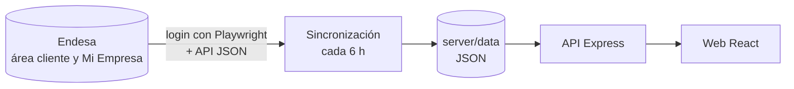

<div align="center">


# Terrazas del Cañaveral · Electricidad

Panel del consumo eléctrico de una comunidad de vecinos: facturas de las zonas comunes y consumo hora a hora de los portales, obtenidos automáticamente del área de clientes de Endesa.


</div>


## Qué muestra

- **Resumen** de los dos contratos: última factura, consumo de los últimos 30 días y su evolución.
- **Consumo diario y por horas**, con la media del período y los fines de semana marcados.
- **Mapa de calor día × hora** para detectar horarios fijos y días anómalos.
- **Consumo de fondo**: lo que gasta la instalación sin uso (luces de emergencia, porteros…).
- **Reparto por periodos de la tarifa 2.0TD** (punta, llano y valle) y perfil horario medio.
- **Facturas con precio medio por kWh** y aviso automático de las que se salen de lo habitual.
- Modo claro y oscuro, y diseño adaptado a móvil, tablet y escritorio.

<table>
  <tr>
    <td width="68%"></td>
    <td width="32%"></td>
  </tr>
</table>

## Cómo obtiene los datos



- Playwright solo se usa para **iniciar sesión**; los datos se piden directamente a la API JSON de Endesa, que es más rápido y estable que leer la página.
- La sincronización corre **en segundo plano**, así que la web lee siempre de disco y carga al instante.
- La sesión se guarda 4 h y se renueva sola si caduca. Si varias peticiones necesitan iniciar sesión a la vez, se abre un solo navegador.
- Los días que Endesa aún no ha leído llegan a 0: no se guardan, y se completan en cuanto llega la lectura real.
- `GET /api/status` informa de la última sincronización y de los errores, y la cabecera de la web lo muestra.

## Puesta en marcha

Requiere **Node.js 22.12 o superior**.

```bash
npm install
npx playwright install chromium   # navegador para el login
cp .env.example .env              # y rellenar las credenciales
npm run dev                       # web en http://localhost:3000 · API en http://localhost:4000
```

## Configuración

Todas las variables están en [`.env.example`](.env.example).

| Variable                                                | Para qué sirve                                                             |
| ------------------------------------------------------- | -------------------------------------------------------------------------- |
| `ENDESA_PORTALES_USER` / `_PASSWORD`                    | Credenciales del área cliente de Endesa                                    |
| `ENDESA_PORTALES_CLIENT_ID` / `_CONTRACT_ID`            | Identificadores del contrato (ver abajo)                                   |
| `ENDESA_COMUNES_*`                                      | Lo mismo para zonas comunes. Sin `CLIENT_ID` solo se muestran sus facturas |
| `ENDESA_BILLING_USER` / `_PASSWORD` / `_SF_CONTRACT_ID` | Portal Mi Empresa, del que salen las facturas                              |
| `ENDESA_*_COOKIE`, `ENDESA_BILLING_AURA_TOKEN`          | Opcionales: sesión manual si el login automático falla                     |
| `SYNC_INTERVAL_HOURS`                                   | Cada cuántas horas se sincroniza (por defecto 6; `0` lo desactiva)         |
| `ADMIN_TOKEN`                                           | Si se define, los `POST …/refresh` exigen la cabecera `x-admin-token`      |

<details>
<summary>Cómo encontrar <code>clientId</code> y <code>contractId</code></summary>

1. Inicia sesión en <https://www.endesa.com/es/area-cliente> y entra en «Mi consumo».
2. Abre las herramientas de desarrollo (F12) → pestaña **Network**.
3. Busca una petición a `consumptions`: ambos valores van en el cuerpo de la petición.

</details>

## Scripts

| Comando                  | Qué hace                                                  |
| ------------------------ | --------------------------------------------------------- |
| `npm run dev`            | Servidor y web en modo desarrollo                         |
| `npm run build`          | Compila la web en `dist/`                                 |
| `npm start`              | Servidor de producción (sirve la API y `dist/`)           |
| `npm run fetch:endesa`   | Sincroniza el consumo (`-- --contract portales` para uno) |
| `npm run fetch:backfill` | Descarga todo el histórico disponible en Endesa           |
| `npm run fetch:all`      | Consumo de todos los contratos y facturas                 |
| `npm run lint`           | ESLint                                                    |
| `npm run format`         | Prettier                                                  |

## Despliegue

El proyecto incluye un `Dockerfile` listo para [Railway](https://railway.app) o cualquier servicio que use Docker:

1. **New Project → Deploy from GitHub repo**. Railway detecta el `Dockerfile`.
2. Añade las variables de entorno en **Settings → Variables**.
3. Monta un **volumen** en `/app/server/data` para que los datos sobrevivan a cada despliegue.
4. Genera un dominio en **Settings → Networking**.

Cada `git push` vuelve a desplegar.

> [!IMPORTANT]
> La web no tiene inicio de sesión: cualquiera con la URL puede ver los datos. Define `ADMIN_TOKEN` y, si no quieres que sea pública, protégela con la autenticación de tu plataforma.

## API

| Método | Ruta                            | Descripción                             |
| ------ | ------------------------------- | --------------------------------------- |
| GET    | `/api/endesa/:contrato/periods` | Períodos de facturación (cache de 12 h) |
| POST   | `/api/endesa/:contrato/period`  | Datos diarios y horarios de un período  |
| GET    | `/api/endesa/:contrato/range`   | Datos entre `?start=` y `&end=`         |
| POST   | `/api/endesa/:contrato/refresh` | Fuerza una sincronización (admin)       |
| GET    | `/api/endesa/billing`           | Facturas de zonas comunes               |
| POST   | `/api/endesa/billing/refresh`   | Fuerza la recarga de facturas (admin)   |
| GET    | `/api/status`                   | Estado de las sincronizaciones          |
| GET    | `/api/health`                   | Estado del servidor                     |

`:contrato` es `comunes` o `portales`.

## Estructura

```
server/
  index.js               Express: API, web compilada y planificador
  env.js                 Carga de .env
  config/                Contratos y credenciales
  routes/                Rutas de la API
  services/sync.js       Sincronización en segundo plano
  scrapers/              Login con Playwright y clientes de la API de Endesa
  utils/dataStore.js     JSON en disco con cache y escritura atómica
  data/                  Datos sincronizados
src/
  components/            Vistas y componentes de la interfaz
  charts/                Gráficos (Chart.js) y su configuración común
  hooks/                 Peticiones con cache compartida
  utils/                 Formato es-ES y cálculos (resúmenes, tarifas, facturas)
  styles/global.css      Estilos y tema claro/oscuro
scripts/                 Sincronización desde la línea de comandos
```
