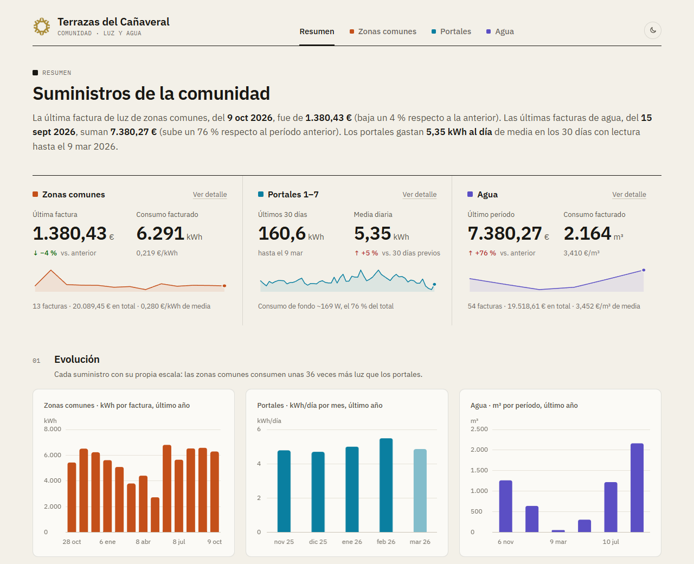
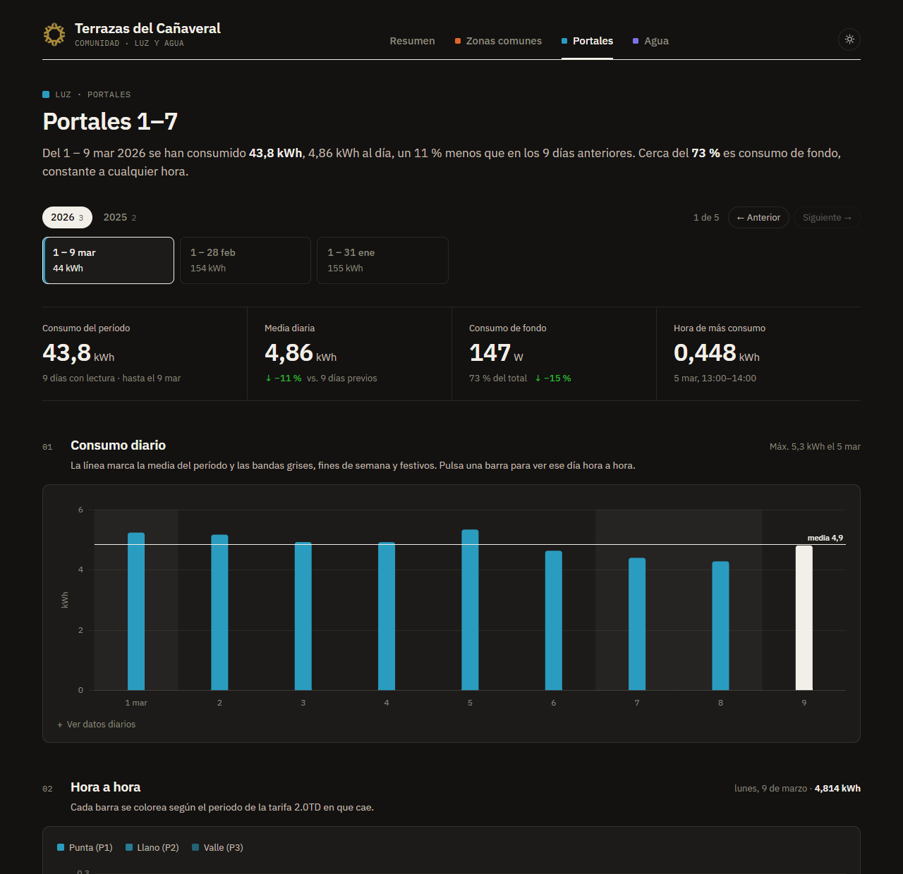
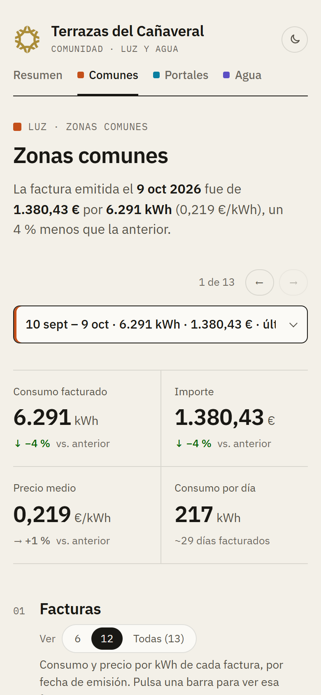

<div align="center">


# Terrazas del Cañaveral · Luz y agua

Panel de los suministros de una comunidad de vecinos: facturas de luz de las zonas comunes, consumo hora a hora de los portales y facturas del agua.


</div>



## Qué muestra

- **Resumen** de los tres suministros: última factura, evolución del último año y facturas recientes.
- **Luz de zonas comunes**: consumo y precio por kWh de cada factura, con aviso de las que se salen de lo habitual.
- **Agua**: los 9 contadores sumados por período de facturación y repartidos por uso (riego y piscina, zonas comunes de cada bloque y contra incendios), con el detalle de cada contador.
- **Consumo diario y por horas** de los portales, mapa de calor día × hora, consumo de fondo y reparto por periodos de la tarifa 2.0TD.
- Filtro para elegir cuántas facturas o meses ver en los gráficos.
- Modo claro por defecto y modo oscuro opcional, adaptado a móvil, tablet y escritorio.

<table>
  <tr>
    <td width="68%"></td>
    <td width="32%"></td>
  </tr>
</table>

## Datos

La web es estática y lee los archivos de [`data/`](data). Para actualizarla basta con editar el archivo correspondiente y hacer `git push`.

| Archivo                  | Contenido                                      |
| ------------------------ | ---------------------------------------------- |
| `data/luz-comunes.json`  | Facturas de luz de las zonas comunes           |
| `data/agua.json`         | Facturas de agua de EMASA, una por contador    |
| `data/luz-portales.json` | Lecturas diarias y horarias de luz de portales |

Cada factura de luz tiene este formato:

```json
{
  "numFact": "P26CON042639607",
  "fEmision": "2026-10-09",
  "consumo": 6291,
  "importe": 1380.43
}
```

Las de agua llevan además el período de EMASA, el contrato, el contador y el uso:

```json
{
  "numFact": "2026EMFF1984190",
  "periodo": "2026-05",
  "fEmision": "2026-09-14",
  "desde": "2026-07-06",
  "hasta": "2026-09-09",
  "consumo": 2,
  "importe": 16.29,
  "contrato": "3876537",
  "contador": "P25AA653863E",
  "uso": "Zonas comunes",
  "bloque": 1
}
```

- `consumo` va en kWh para la luz y en m³ para el agua. Si aún no se conoce, `null`: la factura sale como pendiente y no cuenta para el precio medio.
- `desde` y `hasta` (`YYYY-MM-DD`) son opcionales en la luz: si no están, el período se toma desde la factura anterior.
- En el agua, las facturas con el mismo `periodo` se suman. `uso` es `"Riego y piscina"`, `"Zonas comunes"` (con su `bloque`) o `"Contra incendios"`.
- El orden dentro del archivo no importa.

## Puesta en marcha

Requiere **Node.js 22.12 o superior**.

```bash
npm install
npm run dev     # http://localhost:3000
```

| Comando           | Qué hace                   |
| ----------------- | -------------------------- |
| `npm run dev`     | Servidor de desarrollo     |
| `npm run build`   | Compila la web en `dist/`  |
| `npm run preview` | Sirve la versión compilada |
| `npm run lint`    | ESLint                     |
| `npm run format`  | Prettier                   |

## Despliegue

El workflow [`.github/workflows/deploy.yml`](.github/workflows/deploy.yml) compila y publica la web en GitHub Pages con cada `git push` a `main`. Solo hay que tener **Settings → Pages → Source** en **GitHub Actions**.

La web queda en `https://<usuario>.github.io/<repositorio>/`. No tiene inicio de sesión: cualquiera con la URL puede verla.

## Estructura

```
data/                   Datos de facturas y lecturas
src/
  data.js               Suministros: datos, unidades y nombres
  components/           Vistas y componentes de la interfaz
  charts/               Gráficos (Chart.js) y su configuración común
  utils/                Formato es-ES y cálculos (resúmenes, tarifas, facturas)
  styles/global.css     Estilos y tema claro/oscuro
```
